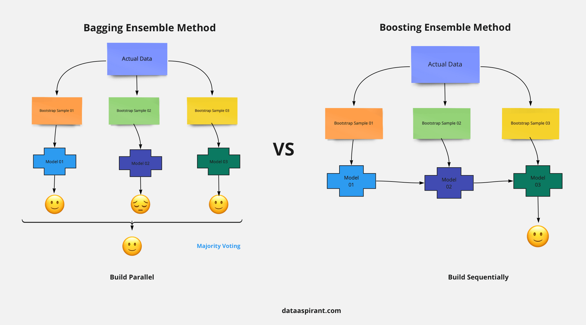
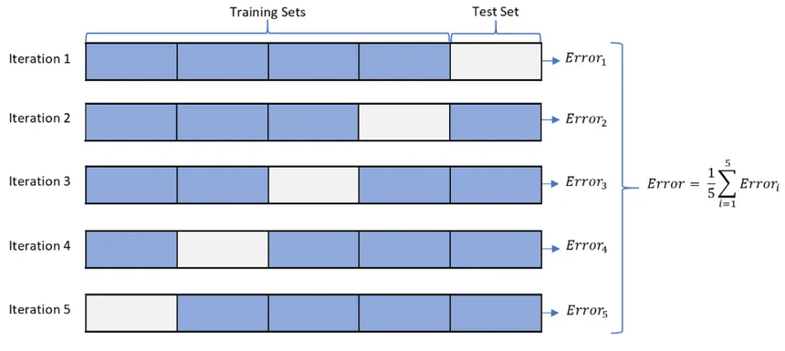

Ensemble techniques in machine learning combine multiple models to improve predictive performance, accuracy, and robustness beyond what any single model can achieve.  These methods leverage the "wisdom of the crowd" principle—where diverse models correct each other’s errors—to reduce overfitting, variance, and bias. 

Key Ensemble Techniques
Bagging (Bootstrap Aggregating): Trains multiple models independently on random subsets of the training data (with replacement). Predictions are combined via averaging (regression) or majority voting (classification).
Example: Random Forest, which uses bagging with decision trees and random feature selection to reduce overfitting. 
Boosting: Sequentially trains models where each new model focuses on correcting errors made by previous ones. Models are weighted based on performance.
Examples: AdaBoost, Gradient Boosting Machines (GBM), XGBoost, CatBoost—all excel in structured/tabular data tasks. 
Stacking (Stacked Generalization): Combines predictions from multiple diverse models (e.g., trees, neural networks) using a meta-model (e.g., logistic regression) that learns how to best weight their outputs. 
Advantage: Can capture complex patterns by integrating heterogeneous models. 
Why Use Ensemble Methods?
✅ Improved accuracy and generalization
✅ Reduced overfitting and variance
✅ Increased robustness to noisy or complex data
✅ Better handling of bias-variance tradeoff 
These techniques are widely used in real-world applications, including Kaggle competitions, financial forecasting, and anomaly detection. Popular tools like scikit-learn provide built-in implementations for bagging, boosting, and stacking.

Gradient Boosting is a powerful ensemble machine learning technique that builds predictive models by sequentially combining multiple weak learners—typically decision trees—to minimize prediction errors.  Unlike simpler boosting methods like AdaBoost, which focus on reweighting misclassified samples, gradient boosting frames the problem as a numerical optimization task, where each new model is trained to correct the residuals (errors) of the previous model using gradient descent on a differentiable loss function. 

How Gradient Boosting Works

Initialization: Start with a simple prediction, such as the mean of the target variable (for regression) or the log-odds (for classification).
Iterative Refinement: In each iteration:
Compute the negative gradient of the loss function with respect to the current predictions—this represents the "pseudo-residuals" or errors.
Train a weak learner (e.g., a shallow decision tree) to predict these gradients.
Add the new model’s predictions to the ensemble, scaled by a learning rate (shrinkage) to ensure gradual improvement and reduce overfitting. 
Stopping Criteria: Repeat until a maximum number of trees is reached, or performance on a validation set no longer improves. 
Key Features
Flexible Loss Functions: Supports various loss functions (e.g., mean squared error for regression, log-loss for classification), enabling use in diverse tasks. 
Strong Performance: Often outperforms random forests and other models, especially on structured/tabular data. 
Robustness: Less sensitive to outliers than AdaBoost due to smooth gradient-based updates. 
Hyperparameters: Learning rate, number of trees, tree depth, and subsampling are critical for tuning.
Common Use Cases
Regression: Predicting continuous values (e.g., house prices).
Classification: Binary or multi-class prediction (e.g., fraud detection). 
Ranking: Used in search engines and recommendation systems.
Note: While gradient boosting is highly effective, it can be computationally expensive and prone to overfitting if not properly regularized. Variants like HistGradientBoosting (in scikit-learn) offer faster training for large datasets. 

K-Fold Cross Validation is a resampling technique used to evaluate the performance of machine learning models by dividing the dataset into k equal-sized folds.  The model is trained on k−1 folds and tested on the remaining fold, with this process repeated k times, ensuring each fold is used as a test set exactly once.  The final performance estimate is the average of the results across all k iterations, providing a robust measure of model generalization. 

Key Benefits
Reduces bias and variance in performance estimation compared to a single train-test split. 
Maximizes data usage, especially valuable for small datasets. 
Helps detect overfitting by testing the model on multiple data subsets. 
Common Practices
k = 10 is widely used as a standard trade-off between bias and variance. 
For imbalanced classification data, use Stratified K-Fold Cross Validation to maintain class proportions in each fold. 
Leave-One-Out Cross Validation (LOOCV) is a special case where k equals the number of data points (computationally expensive). 