# Statistics for Data Science — Beginner Notes

> Dataset used throughout: `data/indian_engineering_student_placement.csv`
> (CGPA, study hours, coding skill, placement-related features of engineering students)

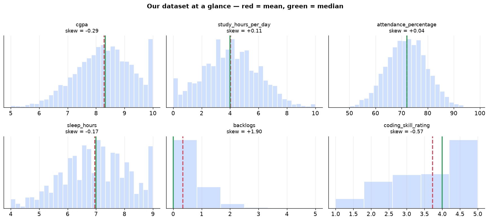
*Our 5,000 students at a glance — red dashed = mean, green = median. Notice how `backlogs` is heavily right-skewed while `attendance_percentage` is almost symmetric.*

---

## 0. Why does a Data Scientist need Statistics?

| Question a business asks | Statistics tool that answers it |
|---|---|
| "What is a typical student's CGPA?" | Mean / Median / Mode |
| "Are students similar or very different?" | Variance / Standard deviation |
| "What does the *shape* of the data look like?" | Distributions |
| "How rare is a CGPA of 9.5?" | Standard normal distribution, Z-score |
| "I can't survey 50,000 students, what do I do?" | Sampling techniques |
| "Did the new training program actually help?" | Hypothesis testing (Z-test) |

**One-line summary:** Statistics is the science of *making confident decisions from incomplete data*.

---

## 1. Population vs Sample (the most important idea first)

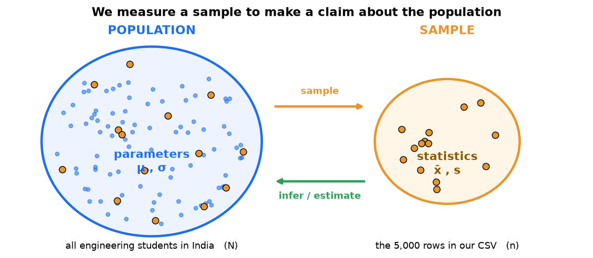

- **Population** = every single unit you care about. Example: *all* engineering students in India.
- **Sample** = the subset you actually measured. Example: the 5,000 rows in our CSV.

| Concept | Population symbol | Sample symbol |
|---|---|---|
| Mean | $\mu$ (mu) | $\bar{x}$ (x-bar) |
| Standard deviation | $\sigma$ (sigma) | $s$ |
| Size | $N$ | $n$ |

A number describing a population is a **parameter**. A number describing a sample is a **statistic**.
We use statistics to *estimate* parameters. That gap is the reason hypothesis testing exists.

---

## 2. Types of Data

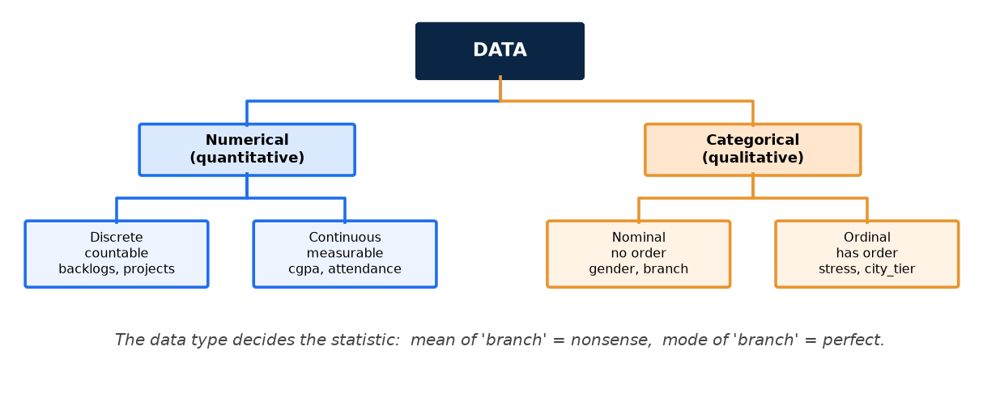

```
Data
├── Numerical (Quantitative)
│   ├── Discrete    → countable  (backlogs, projects_completed, hackathons)
│   └── Continuous  → measurable (cgpa, attendance_percentage, sleep_hours)
└── Categorical (Qualitative)
    ├── Nominal → no order (gender, branch, internet_access)
    └── Ordinal → has order (stress_level low<med<high, city_tier 1<2<3)
```

**Why it matters:** the summary you compute depends on the type.
Mean of `branch` is meaningless. Mode of `branch` is perfect.

---

## 3. Measures of Central Tendency

These answer: *"If I had to describe this whole column with ONE number, what would it be?"*

### 3.1 Mean (average)

$$\bar{x} = \frac{1}{n}\sum_{i=1}^{n} x_i = \frac{x_1 + x_2 + \dots + x_n}{n}$$

**Example:** CGPAs = 6, 7, 7, 8, 9 → mean = 37 / 5 = **7.4**

- Uses every value → very informative.
- **Weakness: extremely sensitive to outliers.**

### 3.2 Median (middle value)

Sort the data, take the middle one.
- If $n$ is odd → the middle value.
- If $n$ is even → average of the two middle values.

**Example:** 6, 7, **7**, 8, 9 → median = **7**

- Robust: outliers barely move it.
- Use for **skewed** data: income, salary, house price, response time.

### 3.3 Mode (most frequent value)

**Example:** 6, 7, 7, 8, 9 → mode = **7**
- The only measure that works for **categorical** data (most common `branch` = CSE).
- Data can be *unimodal*, *bimodal*, or have *no mode*.

### 3.4 The outlier demonstration (memorise this)

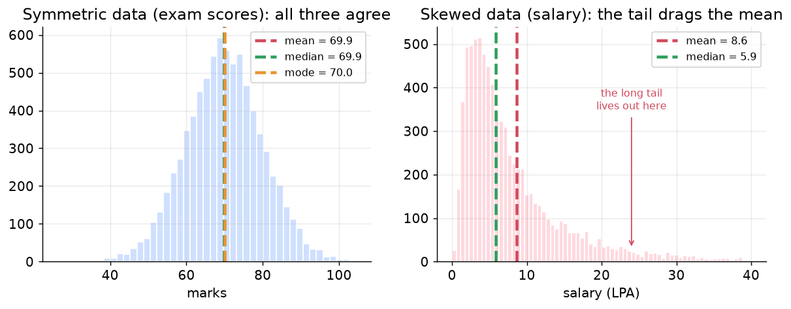

| Data | Mean | Median |
|---|---|---|
| Salaries: 30k, 35k, 40k, 45k, 50k | 40k | 40k |
| Add one CEO: 30k, 35k, 40k, 45k, 50k, **10,000k** | **1,700k** | 42.5k |

The mean says "average salary is 17 lakh/month" — a lie. **The median tells the truth.**

### 3.5 Rule of thumb

| Situation | Use |
|---|---|
| Symmetric, no outliers | Mean |
| Skewed / outliers present | Median |
| Categorical data | Mode |

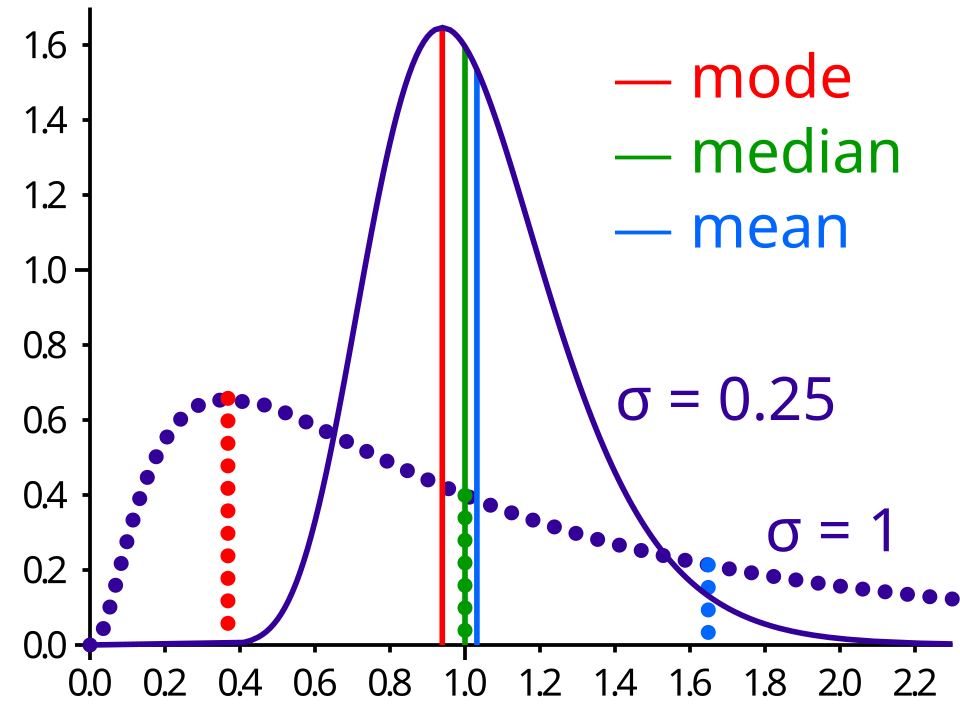
*The mode sits at the peak, the median splits the area in half, and the mean is dragged furthest into the tail.
<sub>Cmglee, CC BY-SA 3.0, via Wikimedia Commons</sub>*

---

## 4. Measures of Dispersion (spread)

Central tendency alone is dangerous.
Two classes both average 7.0 CGPA — one has everyone at 7.0, the other has half at 4.0 and half at 10.0. **Same mean, totally different reality.**

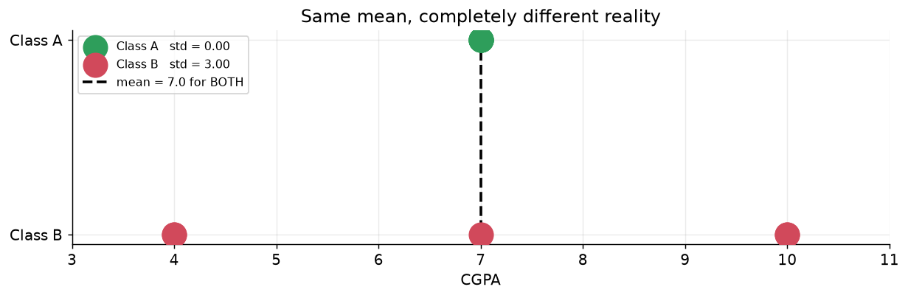

### 4.1 Range
$$\text{Range} = \max - \min$$
Simple, but uses only 2 values → destroyed by a single outlier.

### 4.2 Variance

The average of **squared** distances from the mean.

Population:
$$\sigma^2 = \frac{\sum (x_i - \mu)^2}{N}$$

Sample (note the $n-1$):
$$s^2 = \frac{\sum (x_i - \bar{x})^2}{n-1}$$

**Why square?** Plain deviations $(x_i - \bar{x})$ always sum to exactly zero — positives cancel negatives. Squaring removes signs and punishes large deviations more.

**Why $n-1$ and not $n$? (Bessel's correction)**
A sample's own mean sits "too close" to its own points, so deviations come out too small and we *underestimate* the true spread. Dividing by the smaller number $n-1$ inflates the estimate slightly to correct this bias.
> In pandas, `.var()` uses $n-1$ by default. In numpy, `.var()` uses $n$ by default — pass `ddof=1` to match pandas. **This is a classic interview trap.**

### 4.3 Standard Deviation

$$s = \sqrt{s^2}$$

Variance is in *squared units* (CGPA²  — meaningless). Taking the square root brings us **back to the original unit**, so std dev is what we actually report.

**Interpretation:** "the typical distance of a data point from the mean."

### 4.4 Worked example (do this by hand once!)

Data: 2, 4, 4, 4, 5, 5, 7, 9  → $n = 8$

1. Mean = 40 / 8 = **5**
2. Deviations: −3, −1, −1, −1, 0, 0, 2, 4
3. Squared: 9, 1, 1, 1, 0, 0, 4, 16 → sum = **32**
4. Population variance = 32/8 = **4** → σ = **2**
5. Sample variance = 32/7 = **4.57** → s = **2.14**

### 4.5 Coefficient of Variation (CV)
$$CV = \frac{s}{\bar{x}} \times 100\%$$
Lets you compare spread across *different units* (CGPA vs attendance %). Lower CV = more consistent.

### 4.6 IQR and the outlier rule

- Q1 = 25th percentile, Q2 = median, Q3 = 75th percentile
- $IQR = Q3 - Q1$ (the middle 50% of data)
- **Outlier fences:** below $Q1 - 1.5 \times IQR$ or above $Q3 + 1.5 \times IQR$

This is exactly what a **boxplot** draws.

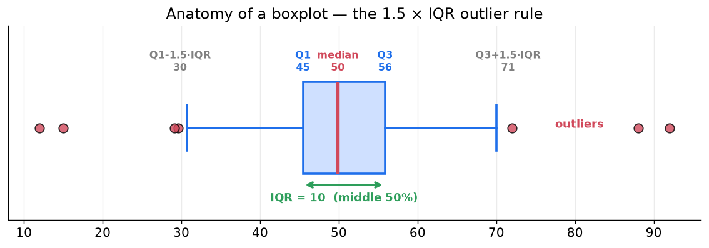

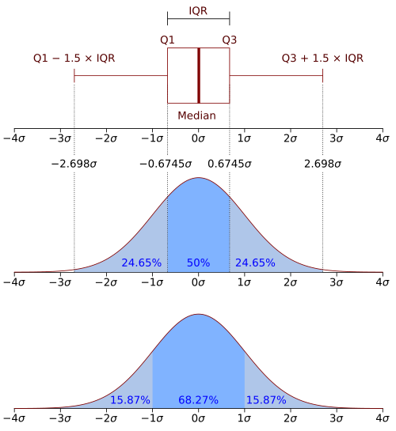
*How a boxplot maps onto a bell curve: the box holds the middle 50% (≈0.67σ each side) and the whiskers reach ≈2.7σ, covering 99.3% of a normal population.
<sub>Jhguch at en.wikipedia, CC BY-SA 2.5, via Wikimedia Commons</sub>*

---

## 5. Distributions

A **distribution** describes *which values occur and how often*.

### 5.1 Shape vocabulary

| Shape | Picture | Relationship |
|---|---|---|
| **Symmetric / Normal** | bell | mean ≈ median ≈ mode |
| **Right (positive) skew** | long tail to the right | mean > median > mode |
| **Left (negative) skew** | long tail to the left | mean < median < mode |

Memory trick: **the tail pulls the mean.**
Right-skew examples: salary, house prices, city population, number of backlogs.

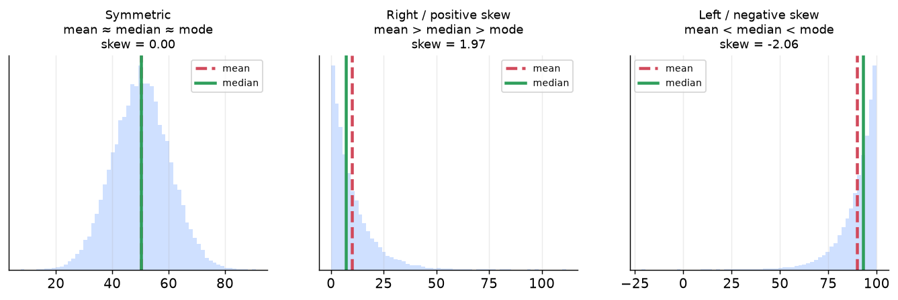

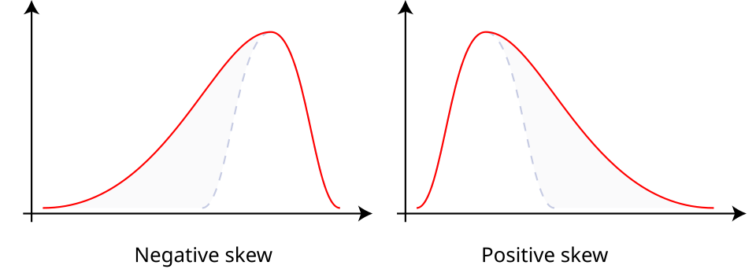
*The name comes from **where the tail points**, not where the bulk of the data sits — the most common beginner mix-up.
<sub>Rodolfo Hermans (Godot) at en.wikipedia, CC BY-SA 3.0, via Wikimedia Commons</sub>*

**Kurtosis** = how heavy the tails are (how often extreme values happen).

### 5.2 Common distributions a beginner should recognise

| Distribution | Used for | Real example |
|---|---|---|
| **Uniform** | every outcome equally likely | fair die roll |
| **Bernoulli** | single yes/no trial | one student placed or not |
| **Binomial** | # successes in $n$ trials | out of 100 students, how many placed |
| **Poisson** | # events in a fixed interval | support tickets per hour |
| **Normal (Gaussian)** | natural measurements | height, CGPA, measurement error |

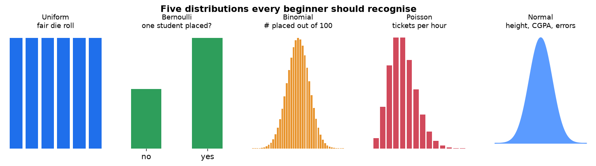

### 5.3 The Normal Distribution

$$f(x) = \frac{1}{\sigma\sqrt{2\pi}} e^{-\frac{(x-\mu)^2}{2\sigma^2}}$$

Properties:
- Bell shaped and perfectly **symmetric** about $\mu$
- Mean = median = mode
- Fully described by just two numbers: $\mu$ and $\sigma$
- Total area under the curve = 1
- Tails approach but never touch the x-axis

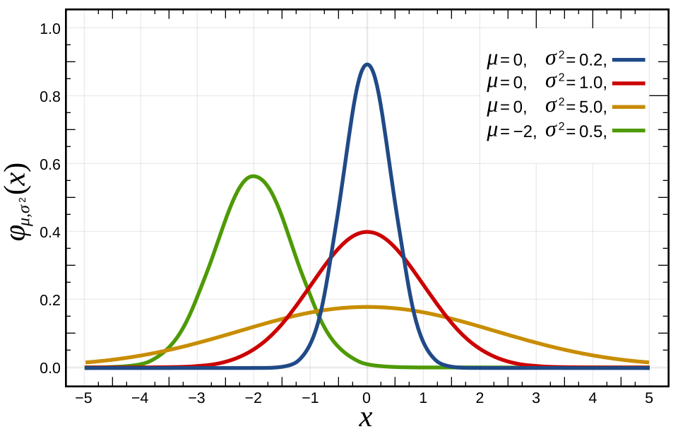
*Change μ → the curve slides left/right. Change σ² → it gets fatter and flatter (or thinner and taller). The area always stays 1.
<sub>Inductiveload, public domain, via Wikimedia Commons</sub>*

### 5.4 The Empirical Rule (68–95–99.7)

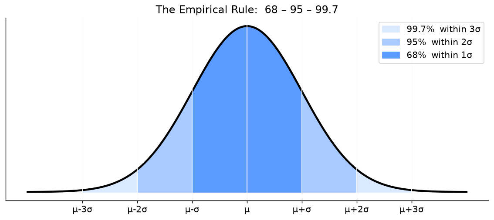

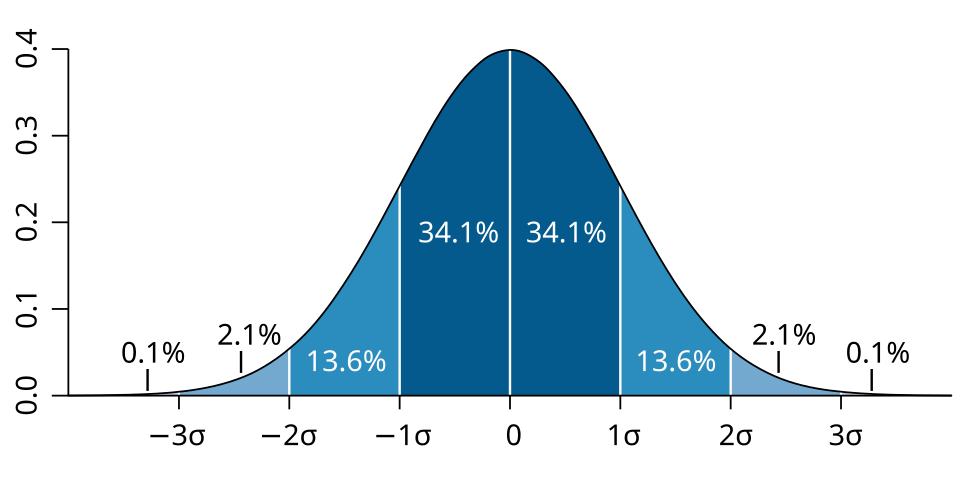
*Each band is one σ wide: 34.1% + 34.1% = 68.2% within 1σ, then +13.6% each side → 95.4%, then +2.1% each side → 99.6%.
<sub>M. W. Toews, CC BY 2.5, via Wikimedia Commons</sub>*

- **68%** of data within **1σ** of the mean
- **95%** within **2σ**
- **99.7%** within **3σ**

**Application:** if CGPA ~ N(7.0, 0.8), then ~95% of students lie between 5.4 and 8.6. A student with CGPA 9.5 is beyond 3σ → genuinely exceptional (top ~0.1%).
This is also the basis of the **3-sigma rule for outlier detection**.

### 5.5 Standard Normal Distribution (Z-distribution)

A normal distribution with $\mu = 0$ and $\sigma = 1$. Written $Z \sim N(0, 1)$.

**Standardization (Z-score):**
$$z = \frac{x - \mu}{\sigma}$$

**Meaning:** "how many standard deviations away from the mean is this value?"
- $z = 0$ → exactly average
- $z = +2$ → 2 std devs above average
- $z = -1.5$ → 1.5 std devs below average

**Why standardize?**
1. Compare apples to oranges — CGPA of 8.5 vs attendance of 92%? Convert both to z-scores.
2. One single lookup table works for every normal distribution.
3. ML algorithms (KNN, SVM, PCA, gradient descent) need features on a common scale → `StandardScaler` does exactly this.

**Worked example:**
CGPA ~ N(7.0, 0.8). Student A has 8.6.
$z = (8.6 - 7.0)/0.8 = 2.0$ → top 2.5% of the class.

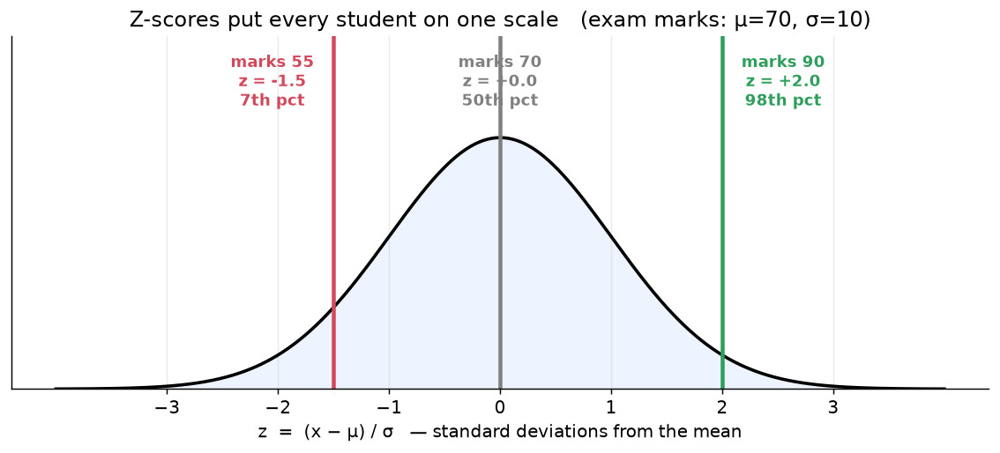
*Exam marks ~ N(70, 10). Raw marks change from exam to exam, the z-score does not — that is what makes scores comparable.*

---

## 6. Basic Probability (just enough to read a normal curve)

### 6.1 Core definitions
$$P(A) = \frac{\text{favourable outcomes}}{\text{total outcomes}}, \qquad 0 \le P(A) \le 1$$

- **Experiment**: an action with uncertain result (rolling a die)
- **Sample space (S)**: all possible outcomes {1,2,3,4,5,6}
- **Event**: a subset of S (rolling even = {2,4,6}) → P = 3/6 = 0.5

### 6.2 Rules

| Rule | Formula |
|---|---|
| Complement | $P(A') = 1 - P(A)$ |
| Addition | $P(A \cup B) = P(A) + P(B) - P(A \cap B)$ |
| Mutually exclusive | $P(A \cap B) = 0$ |
| Independent events | $P(A \cap B) = P(A)\,P(B)$ |
| Conditional | $P(A\mid B) = \dfrac{P(A \cap B)}{P(B)}$ |

**Bayes' Theorem** (foundation of Naive Bayes classifier):
$$P(A\mid B) = \frac{P(B\mid A)\,P(A)}{P(B)}$$

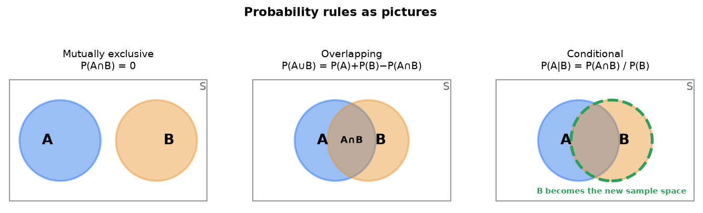
*Conditional probability simply **shrinks the sample space** — once you know B happened, B is the only world left.*

### 6.3 Probability from a continuous distribution

For continuous data, probability = **area under the curve**.
- $P(X = \text{exactly } 7.000) = 0$  (a single point has zero width)
- $P(6.5 < X < 7.5)$ = the shaded area → meaningful

The **CDF**, $P(Z \le z)$, gives the area to the *left* of z. Everything else is derived from it:

| You want | Compute |
|---|---|
| $P(Z \le z)$ | `norm.cdf(z)` |
| $P(Z > z)$ | `1 - norm.cdf(z)` |
| $P(a < Z < b)$ | `norm.cdf(b) - norm.cdf(a)` |

Useful values to remember: `norm.cdf(1.96) ≈ 0.975`, `norm.cdf(1.645) ≈ 0.95`, `norm.cdf(2.576) ≈ 0.995`.

---

## 7. Sampling Techniques

We sample because studying the whole population is too **expensive, slow, or impossible**.

**Goal: a *representative* sample.** A biased sample gives a confidently wrong answer.

### 7.1 Probability sampling (every unit has a known chance of selection)

| Technique | How it works | When to use | Risk |
|---|---|---|---|
| **Simple Random** | pure lottery, every unit equally likely | homogeneous population | may miss small subgroups |
| **Stratified** | split into groups (strata) e.g. by `branch`, sample proportionally from each | subgroups matter / are imbalanced | need to know strata upfront |
| **Systematic** | pick every $k$-th record, $k = N/n$ | ordered lists, production lines | breaks if data has hidden periodicity |
| **Cluster** | split into clusters (e.g. colleges), randomly pick whole clusters | geographically spread population | higher error if clusters differ |

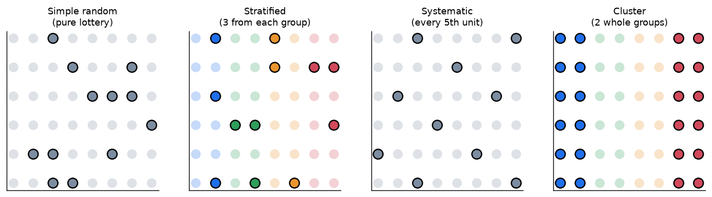
*Faded = population · outlined = selected · colours = strata / clusters*

### 7.2 Non-probability sampling (fast but biased — avoid for inference)

- **Convenience**: whoever is easiest to reach (your own classmates)
- **Judgement/Purposive**: expert picks the sample
- **Quota**: fill fixed counts per group, non-randomly
- **Snowball**: participants recruit others (used for hard-to-reach groups)

### 7.3 Sampling error and standard error

Different samples give different means. That variation is **sampling error**.

$$SE = \frac{\sigma}{\sqrt{n}}$$

**Key insight:** to halve the error you must **quadruple** the sample size ($\sqrt{n}$ law).

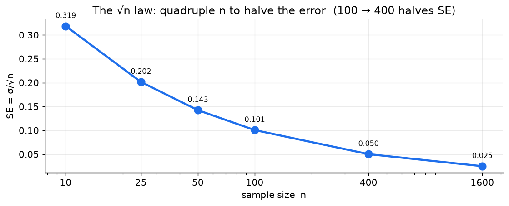

### 7.4 Central Limit Theorem (CLT) — the crown jewel

> If you take many random samples of size $n$ and plot their **means**, that distribution of sample means is approximately **Normal**, with mean $\mu$ and std dev $\sigma/\sqrt{n}$ — **regardless of the shape of the original population** (for $n \ge 30$).

$$\bar{X} \sim N\!\left(\mu,\ \frac{\sigma^2}{n}\right)$$

**Why this is huge:** even if income data is horribly skewed, the *average* income of samples behaves normally. That is what lets us use the Z-test on almost anything.

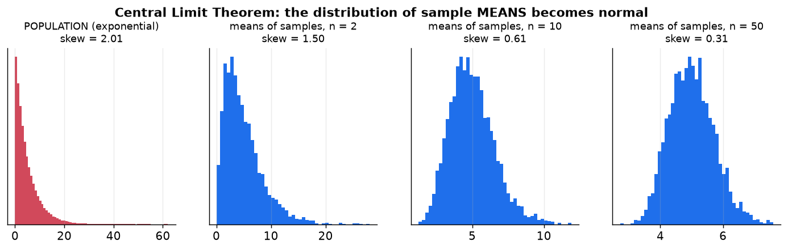

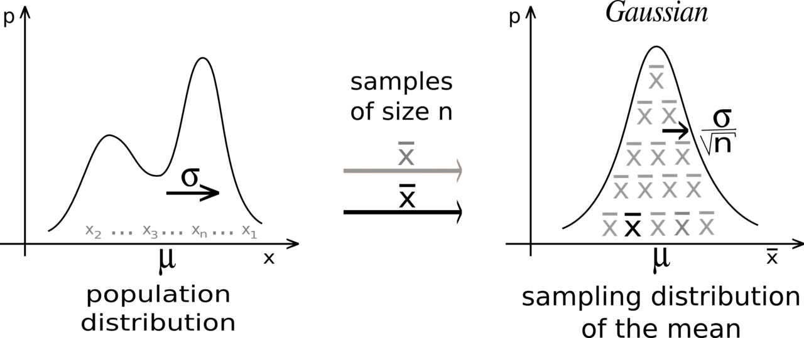
*The population can be **any shape at all**. Average each sample of size n and the distribution of those averages is Gaussian with spread σ/√n.
<sub>Mathieu ROUAUD, CC BY-SA 4.0, via Wikimedia Commons</sub>*

---

## 8. Hypothesis Testing

A formal courtroom procedure for deciding whether an observed effect is **real** or just **random luck**.

### 8.1 The two hypotheses

- **Null hypothesis $H_0$**: "nothing is happening", the status quo. *Assumed true until proven otherwise.*
- **Alternative hypothesis $H_1$ / $H_a$**: what you are trying to prove.

Example:
- $H_0: \mu = 7.0$ (new teaching method did NOT change mean CGPA)
- $H_1: \mu \ne 7.0$ (it did change) — *two-tailed*
- or $H_1: \mu > 7.0$ (it improved) — *one-tailed, right*

> We never "accept" $H_0$. We either **reject** it or **fail to reject** it — like "not guilty" ≠ "innocent".

### 8.2 Significance level, p-value, decision

- **$\alpha$ (alpha)** = risk of a false alarm we accept. Usually **0.05** (5%).
- **p-value** = probability of seeing data *this extreme or more* **if $H_0$ were true**.

| Decision rule | |
|---|---|
| $p \le \alpha$ | **Reject $H_0$** → result is statistically significant |
| $p > \alpha$ | **Fail to reject $H_0$** → not enough evidence |

Equivalent rule using critical values: reject if $|z_{\text{calc}}| > z_{\text{critical}}$.

| Test type | α = 0.05 critical value |
|---|---|
| Two-tailed | ±1.96 |
| One-tailed (right) | +1.645 |
| One-tailed (left) | −1.645 |
| Two-tailed, α = 0.01 | ±2.576 |

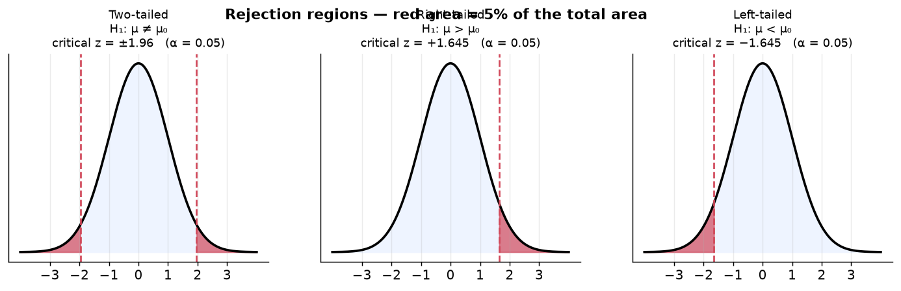
*α is the total red area. A two-tailed test splits it 2.5% + 2.5%, so its cut-off sits further out (1.96 vs 1.645).*

### 8.3 Type I and Type II errors

| | $H_0$ actually TRUE | $H_0$ actually FALSE |
|---|---|---|
| **Reject $H_0$** | ❌ Type I error (α) — false positive | ✅ Correct (Power = 1−β) |
| **Fail to reject** | ✅ Correct | ❌ Type II error (β) — false negative |

Analogy: Type I = convicting an innocent person. Type II = letting a guilty person go free.

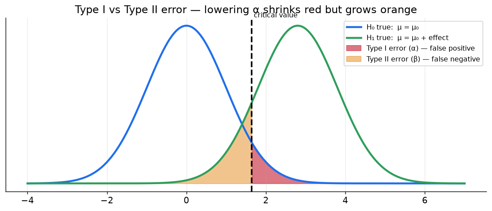
*Push the cut-off right → less red (fewer false alarms) but more orange (more missed effects). The only way to shrink **both** is a bigger sample.*

### 8.4 Z-test

**Use a Z-test when:**
1. Population standard deviation $\sigma$ is **known**, AND/OR
2. Sample size is **large** ($n \ge 30$, so CLT applies)
3. Data is (approximately) normal or n is large

> If $\sigma$ is unknown *and* $n < 30$ → use a **t-test** instead.

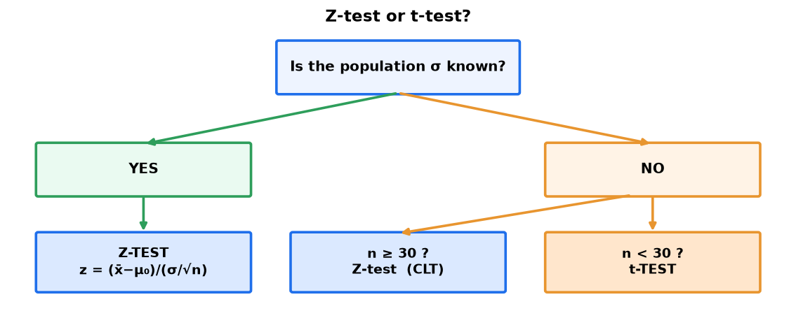

**One-sample Z-test statistic:**
$$z = \frac{\bar{x} - \mu_0}{\sigma / \sqrt{n}}$$

- Numerator = the observed effect (how far the sample mean is from the claim)
- Denominator = the standard error (how much noise to expect)
- So **z = signal / noise**

**Two-sample Z-test:**
$$z = \frac{\bar{x}_1 - \bar{x}_2}{\sqrt{\dfrac{\sigma_1^2}{n_1} + \dfrac{\sigma_2^2}{n_2}}}$$

**Z-test for proportions:**
$$z = \frac{\hat{p} - p_0}{\sqrt{\dfrac{p_0(1-p_0)}{n}}}$$

### 8.5 The 6-step recipe

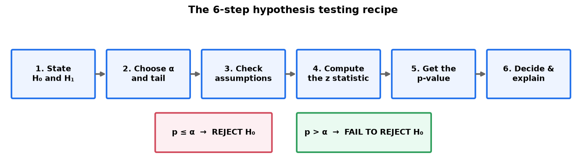

1. State $H_0$ and $H_1$
2. Choose $\alpha$ (usually 0.05) and tail type
3. Check assumptions (n ≥ 30? σ known?)
4. Compute the test statistic $z$
5. Find the p-value (or compare to critical value)
6. **Decide and interpret in plain business language**

### 8.6 Fully worked example

**Claim:** A printer is advertised at **20 pages per minute (ppm)** with σ = 1.5 ppm.
A reviewer tests $n = 36$ printers and measures $\bar{x} = 19.4$ ppm.
**Is the printer slower than advertised?**

1. $H_0: \mu = 20$  |  $H_1: \mu < 20$ (left-tailed)
2. $\alpha = 0.05$ → critical value = −1.645
3. n = 36 ≥ 30, σ known ✔ → Z-test valid
4. $SE = 1.5/\sqrt{36} = 0.25$
   $z = (19.4 - 20)/0.25 = \mathbf{-2.4}$
5. p-value = $\Phi(-2.4) = \mathbf{0.0082}$
6. 0.0082 < 0.05 → **Reject $H_0$**.

> **Interpretation:** There is strong evidence that the printer is slower than the advertised 20 ppm. If the claim were true, we would see a batch this slow only 0.82% of the time.

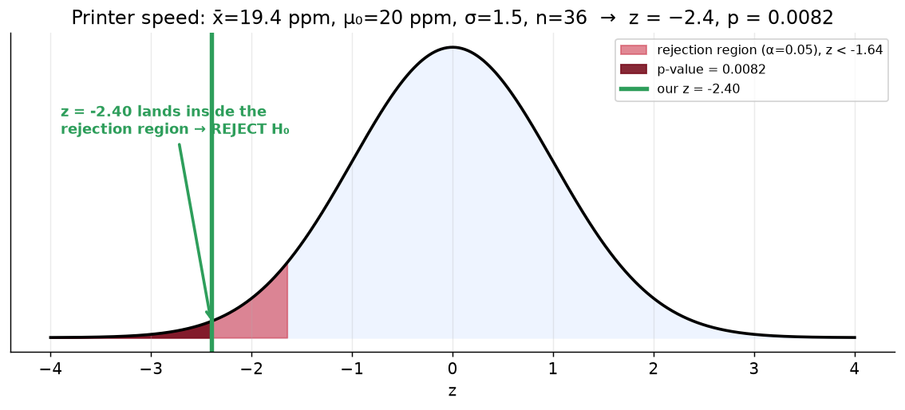

### 8.7 Confidence Interval (the other side of the same coin)

$$CI = \bar{x} \pm z_{\alpha/2}\cdot\frac{\sigma}{\sqrt{n}}$$

For the example: $19.4 \pm 1.96 \times 0.25 = [18.91,\ 19.89]$ ppm
Since 20 is **not** inside the 95% CI, we reject $H_0$ — same conclusion, plus a usable estimate of the real speed.

**Correct reading:** "If we repeated this study many times, 95% of such intervals would contain the true mean."

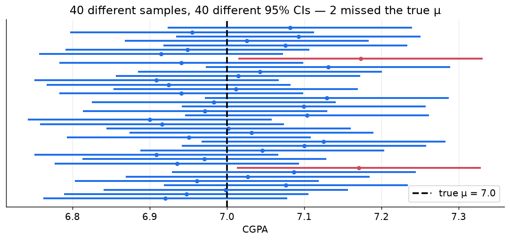
*40 samples → 40 different intervals. About 5% (red) miss the true μ. The **procedure** is 95% reliable, not any single interval.*

### 8.8 Statistical vs Practical significance

With n = 1,000,000 even a 0.001 CGPA difference becomes "significant".
Always ask: *is the effect big enough to matter in the real world?* Report **effect size** (e.g. Cohen's d) alongside the p-value.

---

## 9. Cheat sheet

| Concept | Formula | Python |
|---|---|---|
| Mean | $\sum x/n$ | `df['c'].mean()` |
| Median | middle value | `df['c'].median()` |
| Mode | most frequent | `df['c'].mode()` |
| Variance (sample) | $\sum(x-\bar{x})^2/(n-1)$ | `df['c'].var()` |
| Std dev | $\sqrt{s^2}$ | `df['c'].std()` |
| IQR | $Q3-Q1$ | `df['c'].quantile(.75) - df['c'].quantile(.25)` |
| Skewness | — | `df['c'].skew()` |
| Z-score | $(x-\mu)/\sigma$ | `scipy.stats.zscore(df['c'])` |
| Normal CDF | $\Phi(z)$ | `scipy.stats.norm.cdf(z)` |
| Critical value | $z_{\alpha/2}$ | `scipy.stats.norm.ppf(1-alpha/2)` |
| Random sample | — | `df.sample(n=100, random_state=42)` |
| Stratified sample | — | `df.groupby('branch').sample(frac=0.1)` |
| Z-test | $(\bar{x}-\mu_0)/(\sigma/\sqrt{n})$ | `statsmodels.stats.weightstats.ztest` |

---

## 10. Common beginner mistakes

1. Reporting the **mean** for skewed data (salary) instead of the median.
2. Forgetting `ddof=1` in `np.std()` / `np.var()` for sample data.
3. Saying "we accept the null hypothesis". Say "fail to reject".
4. Thinking the p-value is "the probability that $H_0$ is true". It is not.
5. Using a Z-test with n < 30 and unknown σ (use a t-test).
6. Confusing **correlation** with **causation**.
7. Ignoring sampling bias — a bad sample cannot be fixed by more math.
8. Chasing p < 0.05 by testing many hypotheses (**p-hacking**).

---

## 11. Practice questions

1. Salaries (LPA): 3, 4, 4, 5, 6, 40. Compute mean and median. Which should you report and why?
2. A dataset has mean 50, std dev 5. What range covers ~95% of the data?
3. Exam scores ~ N(70, 10). What percent of students score above 85?
4. You want to survey students across 4 branches with very different sizes. Which sampling technique fits best?
5. $\bar{x}=52$, $\mu_0=50$, $\sigma=8$, $n=64$, $\alpha=0.05$, two-tailed. Compute z and decide.
6. A p-value of 0.03 was obtained with $\alpha = 0.01$. What is your conclusion?

*(Solutions are worked out in the practical notebook: `code/statistics_practicals.ipynb`)*

---

## 12. Files in this folder

| File | What it is |
|---|---|
| `Statistics_Beginner_Notes.md` | this document |
| `Statistics_Beginner_Slides.html` | 54-slide presentation (open in any browser) |
| `Statistics_Beginner_Slides.pdf` | the same deck as a 54-page PDF |
| `code/stats_practicals_slidewise.ipynb` | **practicals mapped 1:1 to the slides** (start here) |
| `code/statistics_practicals.ipynb` | the longer exploratory notebook |
| `code/make_slide_charts.py` | regenerates every chart in `assets/` |
| `code/make_pdf.py` | rebuilds the PDF from the HTML deck |
| `assets/` | the chart images used by the notes and slides |
| `assets/web/` | reference diagrams from Wikimedia Commons — see `assets/web/CREDITS.md` |
